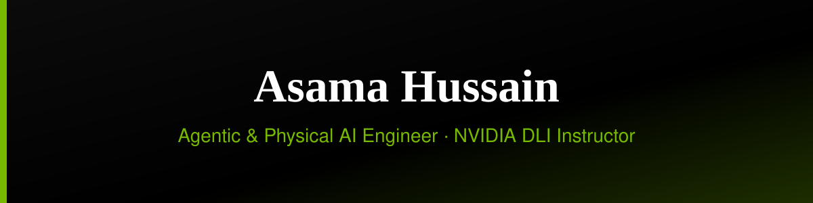

> building agentic and physical AI on the edge.

[](https://www.linkedin.com/in/asama-a-86214318b/)
[](https://orcid.org/0009-0009-3030-8771)

## 🌱 about
```python
asama = {
    "day_job": "lab engineer, australian university of kuwait",
    "teaching": "nvidia dli instructor & university ambassador",
    "community": "build ambassador, spacexsi community kuwait",
    "building": "agentic ai, multi-agent systems, physical ai on jetson",
}
```

## 💼 experience
- **Build Ambassador**, SpaceX Super Intelligence community (Kuwait)
- **NVIDIA DLI Instructor & University Ambassador**, delivered the first NVIDIA DLI workshop in Kuwait on agentic AI with LangChain and LangGraph
- **Lab Engineer**, Australian University of Kuwait

## 💻 projects
| 🔥 [Beacon](https://github.com/Awsama22/beacon-website) | ⚙️ [Beacon API](https://github.com/Awsama22/beacon-api) |
|---|---|
| Satellite fire watch for the whole planet: a 3D globe of live NASA fires, a MODIS + VIIRS record since 2000, and a fire-risk outlook. | Fetches NASA FIRMS fire detections and weather, stores them in PostgreSQL, and serves the Beacon web and mobile apps. |
|    |    |
